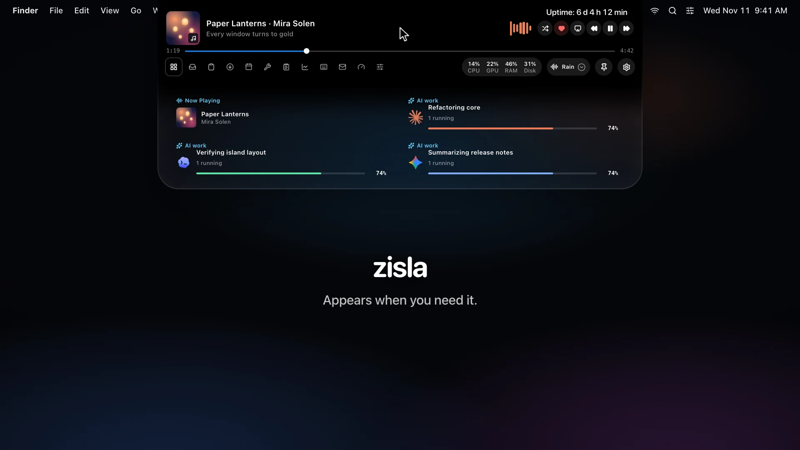

# zisla

[English](../../../README.md) | [简体中文](../../../README.zh-CN.md) | **繁體中文** | [其他語言](../README.md)

**zisla 是一個在需要時出現、平時保持收起的原生 macOS 動態工作空間。** 將滑鼠移到螢幕頂部中央，即可在輕量工作台中查看 AI 任務、媒體、檔案中轉、下載和常用桌面工具；無劉海顯示器也會使用同樣輪廓的模擬狀態條。

當前實現支援 **macOS 14+**。Apple 芯片 Mac 為受支援配置；Intel 機型可能存在可用的發佈包，但不保證兼容性。

[觀看完整功能導覽 — 2 分 40 秒 · 1080p / 60 fps](https://wzz6423.github.io/zisla/media/zisla-launch-1080p60.mp4)

[](https://wzz6423.github.io/zisla/media/zisla-launch-1080p60.mp4)

配樂：Kevin MacLeod《Funkorama》· [CC BY 4.0](https://creativecommons.org/licenses/by/4.0/) · [來源](https://incompetech.com/music/royalty-free/index.html?isrc=USUAN1100474)。

## 為什麼它適合放在螢幕頂部

- **按需出現，不搶焦點。** 從螢幕頂邊展開，必要時固定面板，同時繼續在當前應用中工作。
- **把正在進行的事放在一起。** 無需打開完整儀錶盤，即可查看正在播放、AI 任務、下載、計時器、郵件、系統狀態和電池信息。
- **看見 AI 工作，不讀取對話。** zisla 僅讀取判斷任務狀態所需的結構化事件和本地活動元資料，絕不讀取提示詞或回答正文。
- **控制權留在本機。** 功能模塊、剪貼簿歷史和連結檢測均可獨立開關；權限只在功能首次實際需要時請求。

## 能做什麼

### 保持桌面工作流順暢

| 能力 | 說明 |
| --- | --- |
| 正在播放 | 顯示封面、標題、進度、滾動歌詞和播放控制；沒有媒體元資料時，Core Audio 可識別實際輸出音訊的應用。 |
| 檔案中轉與共享 | 將檔案、音影片或連結拖到螢幕頂部觸發帶，放入中轉站、在 Finder 中定位，或呼叫 macOS 系統共享菜單。 所選檔案與資料夾可壓縮為 ZIP，所選圖片可帶入圖片工具縮放或轉換，成功結果返回中轉；所選圖片、影片與音訊可匯入錄影素材庫，保留目前專案與時間軸。 |
| 剪貼簿與通知 | 可選記錄本機剪貼簿歷史、僅在本機識別新連結，並在收起狀態顯示媒體、AI 活動、瀏覽器下載、計時器、郵件和更新。可選的快捷操作在每次複製後彈出小靈動島提示，展示富內容預覽和智能下一步動作（打開、Finder 定位、搜索、翻譯、計算、儲存）。瀏覽器下載完成或收到 AirDrop 檔案後，也可用同一快捷鍵打開檔案所在資料夾。 新歷史圖片會加入本機文字辨識佇列，可按圖片內文字找回原圖；右鍵圖片可辨識或複製文字。 |
| 日常工作區 | 提供天氣、日曆、提醒事項、Mail.app、以系統「備忘錄」為資料源的 Markdown 筆記、鎖屏信息和可選桌面寵物。 |

### 讓 AI 工作狀態可見

zisla 可監控 Codex、Claude Code、Pi、GitHub Copilot、Gemini、Grok、Kimi Code、Qwen Code、Qoder、ZCode、Zed Agent、Delta、Orca、TRAE、OpenCode、Harnext、WorkBuddy、WorkBuddy AI 等本地活動源，展示任務、狀態、token 趨勢、貢獻熱度圖和側邊通知。

對於沒有穩定本地活動源的工具，可通過 `zislactl` 讓腳本、CI 和工具 hook 上報進度、用量與通知，協議狀態始終儲存在這台 Mac 上。設定中還可檢測、安裝、更新和解除安裝常用 AI CLI，並管理本機 Skills。Provider 與命令見 [CLI 接入設計](mac/Docs/cli-reference.md)。

### 處理桌面上的細碎工作

| 範圍 | 已包含工具 |
| --- | --- |
| 下載與文檔 | 通過 `yt-dlp` 下載影片與音訊；在本機完成 PDF 合併、拆分、旋轉、裁剪、轉換、渲染、文本匯出、水印、頁碼、加密、解除密碼和元資料編輯。 |
| 專注與展示 | 番茄鐘（每段結束播放一次提示音並顯示本機通知）、保持亮屏、防止空閒休眠、螢幕與鍵盤清潔、提詞器和相機鏡子。 |
| 系統與電池 | CPU、GPU、記憶體、磁盤、網路、風扇和電池信息，以及安全可刪除的緩存和日誌清理。 |
| 語音輸入 | 全局快捷鍵錄音與轉寫、可選本地或遠端轉寫整理，以及本機語音記錄。 |

### 當前入口與工作流

島內有 12 個模塊：首頁、中轉、剪貼簿、AI 監控、鍵盤聲音、下載、日程、郵件、隨記、應用混音、小工具和系統。電池在系統中查看；鎖屏屬於獨立展示能力。PDF、圖片、音訊工具從設定進入；螢幕錄影工作室從設定或菜單欄進入。

- **螢幕錄影與創作：** 錄制螢幕、視窗或區域，選擇系統音訊、麥克風和相機；在多軌工作室編輯字幕、縮放、人像與聲音效果，預覽後匯出影片、GIF、Live Photo 或音訊。圖片工具有 9 項本機操作，音訊工具有 27 項操作。
- **混音與播放：** macOS 14.4+ 可逐應用調節音量與靜音；媒體區域可選擇輸出設備，設定可選擇播放器偏好。
- **桌面與會議：** Dock 和 Command+Tab 視窗預覽、網頁/視窗/桌面位置便簽、會議開始前 10 分鐘倒計時、加入會議及關聯便簽。拖拽檔案時搖動滑鼠可顯示中轉投放入口。
- **每日簡報：** 8 種模板，預覽、手動或定時 PNG 匯出，選擇統計內容和獨立儲存位置。
- **AI 賬戶：** 查看支援賬戶的剩餘額度、重置時間、低額度通知和採樣時間；本機 token 歷史可匯出 `.xlsx`。
- **快捷操作：** 彈窗內 `Command+1` 到 `Command+0` 按動作順序執行；新配置額外預設觸發鍵為 `Command+N`，用於首個動作。已儲存組合和清空狀態在升級時保留。

[用戶幫助](https://wzz6423.github.io/zisla/?lang=zh-Hant#help) 提供剪貼簿、截圖／螢幕錄影、中轉、會議、AI、媒體工具、每日簡報、桌面便箋／視窗預覽與播放／混音九組逐步指南，以及短片段示範。 [macOS 指南](mac/README.md#儲存位置)列出各工具儲存目錄與依賴。

## 快速開始

### 安裝應用

從 [GitHub Releases](https://github.com/wzz6423/zisla/releases) 或 [Gitee Releases](https://gitee.com/wzz6423/zisla/releases) 下載最新 DMG，掛載後將 `zisla.app` 拖入 `Applications`。

也可以用 Homebrew 安裝：

```bash
brew install --cask wzz6423/tap/zisla
```

Homebrew 會按你的芯片選擇對應架構的包，Apple Silicon 與 Intel 各自只下載自己那一份。該 cask 來自第三方 tap `wzz6423/tap`，不在 Homebrew 官方 cask 倉庫中，安裝即意味著信任這個 tap。

啓動後，將滑鼠移到當前螢幕頂部中央即可展開；也可從菜單欄圖標選擇“顯示靈動島”。發佈包未經公證，因此無論用哪種方式安裝，首次打開都需要在“系統設定 > 隱私與安全性”中選擇“仍要打開”，或自行清除隔離標記：

```bash
xattr -d com.apple.quarantine /Applications/zisla.app
```

### 更新應用

無論用哪種方式安裝，zisla 都通過 Sparkle 自行更新。用 Homebrew 安裝的情況需要額外說明：`brew upgrade` 只在已裝應用確實舊於 tap 中的版本時才替換它——Homebrew 5.1.6 起會讀取應用包內的版本號，因此它既不與 Sparkle 相爭，也不會放著落後的安裝不管。顯式指定 cask 依據的是 Homebrew 自己的安裝記錄，可能把 Sparkle 更新過的應用退回 tap 的版本：

```bash
brew upgrade --cask zisla
```

tap 只提供正式版，預覽包僅發佈在 Releases，`brew upgrade` 不會把你帶到預發佈版本；反過來，正在用預覽版時顯式指定 cask 會把它替換成當前正式版。Sparkle 自身從不降級，切回 Release 通道後會停在預覽版本，直到正式版的構建號超過它。`brew uninstall --cask zisla` 解除安裝應用，`brew uninstall --zap --cask zisla` 會連同本地資料一起清除。

### 從源碼運行

開發環境需要 Swift 6 / Xcode 16+；僅安裝 Command Line Tools 也可構建。

```bash
cd mac
swift run zisla
```

下載器需要 `yt-dlp`，`ffmpeg` 為可選依賴；Office 轉 PDF 需要 LibreOffice 或 OpenOffice。構建、測試和打包命令見 [macOS 開發指南](mac/README.md)。

## 設計為不打擾工作

- 支援多顯示器、Spaces 和普通全屏應用；展開時不會激活或搶走當前應用焦點。
- 隱藏狀態不創建常駐透明熱區視窗，也不運行幀循環；通過全局事件監聽與幾何判斷觸發展開。
- 使用單層系統材質；系統開啓“降低透明度”後自動使用實體背景。
- 物理劉海通過系統安全區域推斷；無劉海的外接顯示器使用同樣輪廓的覆蓋層。

具體實現取捨見 [架構與性能設計](mac/Docs/architecture.md)。

## 隱私與權限

zisla 僅在啓用的功能首次實際需要時請求系統權限。你可以隨時在設定中關閉模塊，或在 macOS 系統設定中撤銷授權。

| 範圍 | 邊界 |
| --- | --- |
| AI 活動 | 僅讀取結構化事件和本地活動元資料，絕不讀取提示詞或回答正文。 |
| 剪貼簿與檔案 | 剪貼簿歷史、連結檢測和快捷操作是獨立的本地開關；快捷操作處理已完成的瀏覽器下載與收到的 AirDrop 檔案，不受“瀏覽器下載進度”開關影響。識別全部在本機完成，僅在用戶明確點擊或按下觸發鍵後才打開連結或執行動作。檔案中轉使用安全書簽，不複製原始檔案。 |
| 備忘錄、郵件與語音 | 備忘錄和郵件通過 AppleScript/JXA 訪問，並要求自動化授權。語音僅在主動使用時錄音；整理功能只向選定的本地模型、遠端 Provider 或 CLI 檔案發送轉寫文本。 |
| 瀏覽器下載與媒體 | 使用 macOS 公共檔案進度、MediaRemote 元資料和 Core Audio 輸出狀態，不讀取瀏覽器歷史資料庫。系統波形和應用混音在本機處理音訊；螢幕錄影僅在啓用對應源時儲存聲音。 |
| 網路 | 天氣、公網 IP 查詢、更新鏡像選擇、下載、啓用的 AI 額度檢查和依賴/CLI 安裝訪問對應服務。可選翻譯、語音整理與螢幕錄影 AI 編輯訪問選定 Provider 或 CLI；Apple 語音識別是否聯網取決於系統與語言支援。 |

### 按功能授權

首次使用相關功能時，zisla 會請求所需授權。若此前拒絕過，可在「系統設定 > 隱私與安全性」中打開對應項目並允許 `zisla`；macOS 版本不同，項目名稱可能略有差異。

| 授權或系統設定項目 | 何時需要 | 授權後的範圍 |
| --- | --- | --- |
| 設備控制和資料訪問（部分版本顯示為「輔助功能」） | 將語音轉寫自動填入當前應用的輸入框 | 讀取並定位非密碼輸入框，通過系統輔助功能接口或 `Cmd+V` 投遞轉寫；未授權時轉寫仍會複製到剪貼簿。 |
| 麥克風 | 語音輸入或啓用工作室麥克風 | 為錄制或已啓用的監聽採集所選麥克風。 |
| 語音識別 | 將錄音轉為文字 | 僅處理主動錄入的語音。語音輸入需要同時允許「麥克風」和「語音識別」。 |
| 完全磁盤訪問權限 | Mail.app 未運行時查看郵件 | 讀取 `~/Library/Mail` 的本地索引，以顯示賬戶、發件人、主題、摘要、時間和已讀狀態。此處的 Mail 索引讀取路徑需要該授權。 |
| 自動化 | 讀取、撰寫、回復、標記或刪除 Mail.app 郵件；讀寫系統「備忘錄」 | 允許 zisla 控制相應的系統應用；郵件操作和隨記分別可在系統設定中撤銷。 |
| 日曆；提醒事項 | 使用日程模塊 | 分別讀取並管理日曆事件和提醒事項。 |
| 定位服務 | 使用當前位置天氣 | 僅獲取一次當前位置，不持續跟蹤；手動添加的地點不需要定位權限。 |
| 相機 | 打開鏡子或啓用工作室相機預覽/錄制 | 僅在對應功能運行時使用所選相機。 |
| 輸入監控 | 鍵盤聲音、按鍵統計、鍵盤清潔與修飾鍵/滑鼠側鍵快捷鍵 | 按啓用功能監聽事件；按鍵統計儲存在本機。 |
| 藍牙 | 在系統 → 電池中查看配件電量 | 僅讀取已連接或已配對設備公開的電量信息。 |
| 螢幕錄影與系統錄音（舊版 macOS 可能顯示為「螢幕錄制」） | 截圖、視窗預覽、螢幕錄影、系統音訊波形與應用混音 | 讀取螢幕圖像和所選音訊源；螢幕錄影在本機儲存啓用的源，混音需要 macOS 14.4+。 |
| 通知 | 使用番茄鐘提醒 | 在計時結束時播放一次提示音並顯示本機通知。 |
| 用戶選擇的資料夾（無需手動授權） | 檔案中轉、匯入匯出或選擇下載目錄 | 通過系統檔案選擇器取得你選定目錄的訪問權，不需要為這些功能授予完全磁盤訪問權限。 |

撤銷任一授權只會停用對應功能，不影響其他模塊。若在系統設定中剛剛修改開關但功能仍不可用，退出並重新打開 zisla 後再試。

完整的權限與網路行為見 [macOS 開發指南](mac/README.md#權限和隱私)。

## 文檔

| 文檔 | 用途 |
| --- | --- |
| [macOS 開發指南](mac/README.md) | 模塊、AI 接入、依賴、構建、測試、權限與系統限制。 |
| [官網開發指南](../../../web/README.zh-CN.md) | 本地開發、生產構建與當前下載連結。 |
| [宣傳片製作指南](../../../promo/README.zh-CN.md) | Remotion 預覽、渲染、合成、配樂與素材許可。 |
| [架構與性能設計](mac/Docs/architecture.md) | 頂部觸發、視窗行為、併發、媒體與下載安全設計。 |
| [CLI 接入設計](mac/Docs/cli-reference.md) | `zislactl` 的 Provider、命令、字段與退出碼。 |
| [簽名與發佈設計](mac/Docs/releasing.md) | 簽名、公證、DMG、更新通道與發佈驗收。 |
| [貢獻指南](CONTRIBUTING.md) | 開發環境、分支、提交和 Pull Request 要求。 |

## 貢獻

歡迎提交 Issue 和 Pull Request。開始前請閱讀 [貢獻指南](CONTRIBUTING.md)；安全問題請通過 [GitHub Security Advisories](https://github.com/wzz6423/zisla/security/advisories/new) 私下報告，不要公開提交 Issue。

## 許可證

[PolyForm Noncommercial License 1.0.0](../../../LICENSE.md)。允許非商業使用；禁止出售本軟體或用於其他商業用途。
